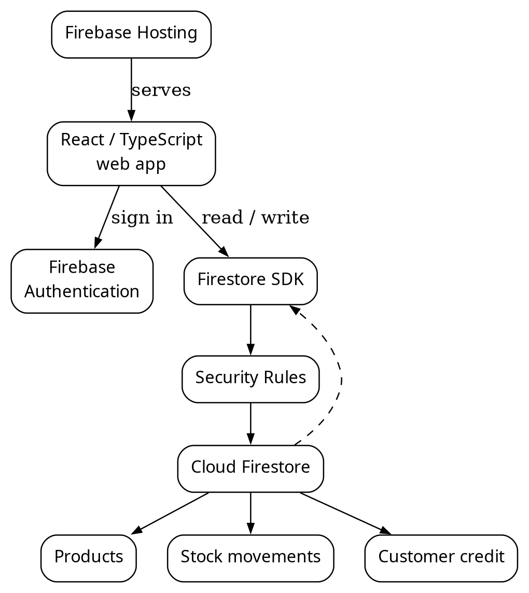
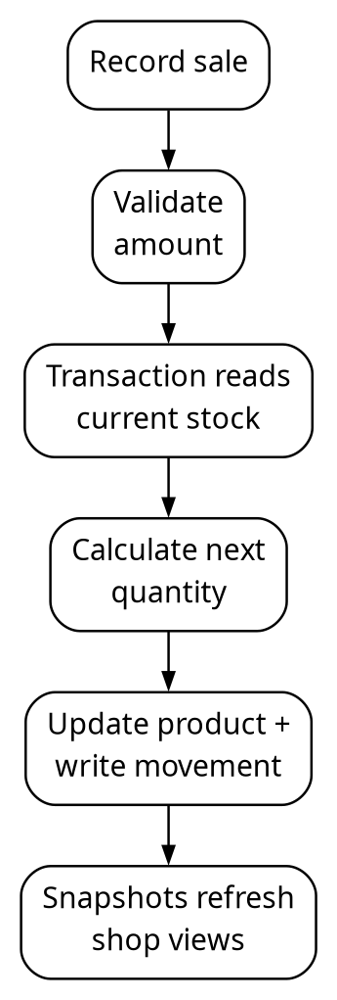
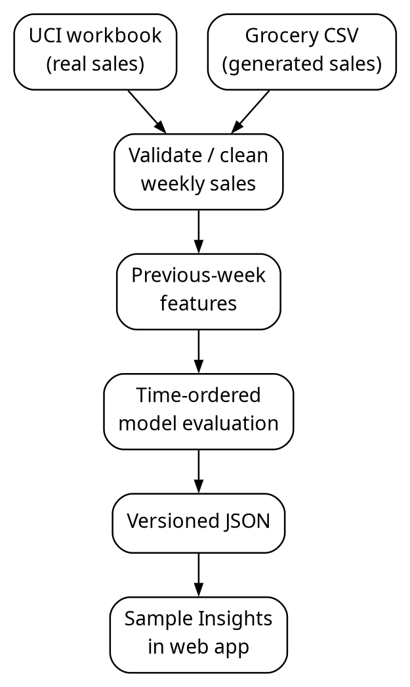
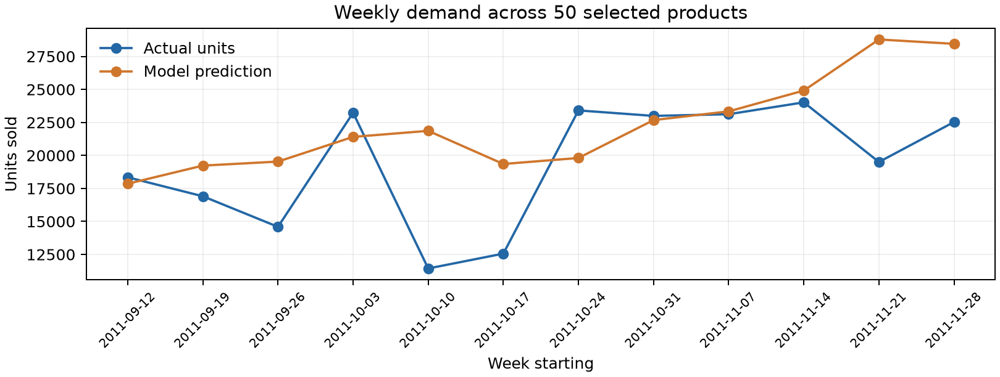
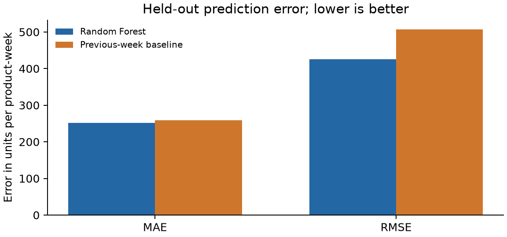

# ABSTRACT

StockSync is a responsive inventory application for a small shop. It uses Firebase Authentication to identify users, Cloud Firestore to store products and timestamped stock movements, Security Rules to restrict access, and Firebase Hosting to deliver the web app. A shopkeeper can record sales, returns, restocks, damage, and physical counts; see low-stock and reorder indicators; and inspect the reason for each stock change. Firestore listeners synchronize the same shop across signed-in devices. Connected stock changes use transactions so concurrent sales do not silently overwrite one another.

The analytics component examines weekly product sales. Its primary experiment uses the real UCI Online Retail II dataset: 1,067,371 transaction rows from a UK retailer in 2009–2011. After documented cleaning, the pipeline retains 924,913 sales in complete weeks. A Random Forest regressor uses prior-week sales, price, product identity, and calendar week to predict weekly units for 50 products. The final 12 weeks, containing 600 product-week observations, are held out chronologically. The model achieves mean absolute error (MAE) 251.286 units, root mean squared error (RMSE) 426.056, and R² 0.278, compared with a previous-week baseline MAE 258.475, RMSE 507.413, and R² -0.024. The improvement is modest and does not justify automatic purchasing decisions.

A second, deterministic **synthetic** grocery dataset has 52 weeks of sales for ten products. Its product CSV can be imported into StockSync, and its weekly sales CSV feeds the same lag-feature and model-evaluation approach. The app displays its derived results as a clearly labeled sample. This is a demonstration of a shared data shape and end-to-end workflow, not independent evidence that the model works for a real shop. The app's own Firestore sale movements are the intended source for future shop-specific analysis after enough genuine history exists. They are not currently sent to the Python pipeline.

**Keywords:** cloud inventory, Firebase, Firestore, transaction, real-time synchronization, weekly sales, Random Forest regression, chronological validation, synthetic demo.

## 1. INTRODUCTION

### 1.1 Background

Small retailers often maintain inventory in a notebook or spreadsheet. A product count can become stale when several people sell or replenish stock. A reorder may be missed because no one notices a low quantity until a customer asks for the item. These are operational problems that benefit from a shared, current record. Once sales have been recorded over time, the same history can also support descriptive analysis and cautious estimates of future sales.

StockSync brings these two ideas into one project. The Cloud Computing (CC) part captures and synchronizes shop activity. The Statistics and Data Analytics (SDA) part cleans transaction data, builds weekly product series, tests a regression model, and presents measured results. The system is intentionally small: a React client and managed Firebase services for daily operations, with an offline Python pipeline for reproducible analysis. There is no model server or scheduled training job in the deployed application.

### 1.2 Problem statement

The operational question is: **What is on hand, what needs replenishment, and why did the count change?** The analytical question is: **How well can next week's sales be estimated from earlier product sales, and does a model outperform a simple previous-week rule?** These questions are related but not identical. Stock on hand is a state; units sold are events. A forecast concerns future sales, while a reorder decision also needs current stock, existing orders, lead time, and the cost of error.

### 1.3 Objectives

1. Give a small shop a secure, shared product and stock ledger.
2. Record stock changes with their type, amount, actor, and time.
3. Update connected views promptly and handle concurrent changes safely.
4. Surface low stock, orders, expiry, recent sales, and customer credit in the workflow.
5. Create a reproducible analysis of real retail transactions with explicit cleaning rules.
6. Evaluate weekly product-sales prediction against a naive baseline on future weeks.
7. Show the analytical result in the app without misrepresenting historical or generated data as this shop's demand.
8. Establish a simple, documented data shape that can eventually connect genuine shop sales to the analysis pipeline.

### 1.4 Scope and implemented status

The live CC app and the UCI SDA experiment are implemented. A generated grocery sample dataset and its derived app view are also implemented. Shop-specific machine learning from a user's Firestore movements is **proposed, not implemented**. Product CSV import creates a product catalog and opening stock; it does not import past sale movements or backdate them. This distinction matters because otherwise the report would appear to claim an integration the application does not yet perform.

## 2. TECHNOLOGY AND FEASIBILITY

### 2.1 Technology stack

| Layer | Technology | Purpose |
|---|---|---|
| Web interface | React, TypeScript, Vite, Tailwind CSS | Product and sales workflow, responsive pages, build |
| Identity | Firebase Authentication | Email/password and Google sign-in, verified identity |
| Cloud data | Cloud Firestore | Products, movements, customer credit, shop profile, staff membership |
| Access control | Firestore Security Rules | Owner/staff permissions and field validation |
| Delivery | Firebase Hosting | Static production web app |
| Analysis | Python, pandas, NumPy, scikit-learn | Cleaning, aggregation, feature construction, regression, metrics |
| Report graphics | Matplotlib | Test-period trend and error comparison |

Firebase removes the need to operate a separate application server for the inventory workflow. The Python analysis is deliberately run by the developer when preparing or updating results. Its small JSON output is bundled into the web app. These choices fit a mini project and keep cloud costs and moving parts low. No performance, cost, or availability guarantee for a large commercial deployment is claimed.

### 2.2 Feasibility of a shared dataset

One dataset can serve both subjects if its records represent the same business events. A product table alone is insufficient for forecasting; the data must also include **dated sales quantities**. StockSync's Firestore movements already provide `productId`, `kind`, `change`, timestamps, and optional revenue, so genuine sales can be converted into weekly product totals. However, a new shop has too little history to validate a forecast. A generated dataset supplies repeatable demonstrations and tests, while a real-world source supplies an independently collected SDA evaluation. Generated examples must never be described as observed customer activity.

## 3. SYSTEM ANALYSIS AND REQUIREMENTS

### 3.1 Users and principal workflows

The owner manages the catalog, thresholds, stock, customers, and staff access. A staff member can record allowed stock changes but cannot edit prices or catalog details. A shopper does not access this back-office app. A new owner can create products manually, import a product CSV, or explore disposable sample products during setup. A sale reduces quantity and writes a movement. Reorder and History reflect the resulting state. The sample Insights page contains dated, external or generated analyses and is separate from the live inventory calculations.

### 3.2 Functional requirements and evidence

| ID | Requirement | Implemented evidence |
|---|---|---|
| CC1 | Authenticate and separate shops | Firebase Auth, owner-scoped Firestore paths, Security Rules |
| CC2 | Create and import products | Product form, `ImportProducts`, CSV parser |
| CC3 | Record stock changes | `RecordPage`, transaction-backed movement writer |
| CC4 | Prevent connected lost updates | Firestore transaction reads current product before write |
| CC5 | Explain stock changes | Immutable-style movement history and undo movement |
| CC6 | Show stock risk and orders | Overview, low-stock status, Reorder page |
| CC7 | Synchronize views | Firestore `onSnapshot` subscriptions |
| CC8 | Work with limited connectivity | Cached reads and restricted queued relative writes |
| SDA1 | Use a real-world dataset | UCI Online Retail II workbook |
| SDA2 | Clean and transform data | `analytics/build.py`, removal counts and weekly grid |
| SDA3 | Train and evaluate regression | Random Forest, last-12-week holdout, baseline comparison |
| SDA4 | Display results and limitations | Insights page, technical details page, generated JSON |
| INT1 | Use one generated demo data shape | Grocery product CSV, weekly sales CSV, demo analysis JSON |
| INT2 | Train on the current shop's Firestore sales | Not yet implemented; proposed after genuine history accumulates |

### 3.3 Non-functional requirements

The interface must work at narrow phone widths and provide English/Hindi labels. Firestore writes must obey server-enforced rules, not only client validation. A failed or offline transaction must not be presented as saved. Analytical outputs must identify their source, date range, and whether the data are observed or generated. Re-running a pipeline on the same input should produce the same output. The raw UCI workbook and private shop records must not be bundled into the public website.

## 4. ARCHITECTURE AND DATA DESIGN

### 4.1 Cloud workflow



**Figure 1:** StockSync cloud architecture and real-time data path.

Hosting delivers static assets. The client uses Firebase Auth and the Firestore SDK directly. Rules restrict reads and writes to the shop owner or an authorized member. Firestore listeners keep product, history, and dashboard views updated. This is a managed cloud application despite having no custom backend server.

### 4.2 Main Firestore entities

| Path or entity | Important fields | Role |
|---|---|---|
| `users/{uid}/products/{id}` | name, SKU, category, quantity, thresholds, prices, timestamps | Current catalog and stock state |
| `users/{uid}/movements/{id}` | productId, kind, change, before/after quantity, note, actor, time, optional revenue/profit | Stock event history |
| `users/{uid}/customers/{id}` | customer identity and balance | Credit account |
| `users/{uid}/creditEntries/{id}` | customerId, amount, note, time | Credit ledger |
| shop profile and membership records | name, shop kind, setup state, invitations/roles | Shop configuration and access |

`productId` links a movement to the product it affected. Movement records retain a product name so History remains understandable if the catalog changes. Current `quantity` is a convenient state field and the movement history explains how the app reached that state. The history is not a cryptographically protected audit trail against an owner who can control their own client or Firebase project.

### 4.3 Sale and stock update flow



**Figure 2:** Connected sale flow and atomic stock update.

If two clients start from the same displayed count, a transaction retries when a read product changes before commit. Both valid sales can then be applied to the latest quantity. Credit sales update the customer's balance and credit ledger in the same transaction. The browser has a separate, constrained path for offline relative changes; absolute counts and order receipts need a connection. An offline movement's displayed before/after count may be approximate if another device writes first.

### 4.4 Analysis data flow



**Figure 3:** The two implemented analysis sources and their public derived results. A private Firestore-to-model flow is future work.

The two bundled JSON files are public static assets. They contain no user account data. The UCI workbook stays in ignored local `analytics/data/`; it is neither committed nor uploaded to Firestore. The generated CSVs are committed because they are small, artificial examples intended for reproduction.

## 5. CLOUD IMPLEMENTATION

### 5.1 Product and stock functions

A product has a quantity on hand, alert threshold, optional target stock, on-order amount, price, unit, pack size, and expiry date. A product is sold out at zero and low when its positive quantity is at or below the alert threshold. A reorder suggestion is the positive gap to target after subtracting stock already on order. The app supports pieces, kilograms, and litres. Sales, returns, damage, restocks, and corrections produce movements with signed quantity change. A sale can record a real amount larger than the current count through an explicit oversell path, leaving recorded stock at zero and noting the discrepancy.

### 5.2 User experience

The Overview presents on-hand totals, low-stock and sold-out counts, recent changes, sales, and reorder indicators. Record handles sales, counts, and customer credit. Products supports search, SKU/barcode lookup, editing, and CSV import. Reorder accounts for targets and open orders. History lets the owner inspect and export changes. The interface has five primary mobile tabs; Insights opens from Overview. The main Insights screen uses plain-language descriptions, while data source, model settings, metrics, and test rows live on a details page.

### 5.3 Authentication, rules, and privacy

Firebase Authentication supports Google and email/password sign-in, verification, and reset. Rules require a verified account for protected shop data. Owner and member permissions are enforced in rules, including limits on member product edits. Product and movement fields are validated. An unrelated account cannot read another owner's inventory. The app stores customer credit details, so those records must remain owner-scoped and should never be copied into a public analysis file. Sign-out waits for pending writes and clears the local Firestore browser cache when possible.

### 5.4 Deployment

The production app is built with `npm run build` and served from Firebase Hosting. The Firebase project ID in this checkout is `stocksync-b43cd`; the current application URL is https://stocksync-b43cd.web.app/. Hosting deploys the frontend bundle, not the raw UCI workbook or the developer's Python virtual environment. Security Rules require a separate rules deployment when they change. A service worker may cache an older bundle, so a post-deployment reload and asset check are part of practical verification.

## 6. DATASET DESIGN AND PROVENANCE

### 6.1 Real-world analytical dataset

The primary source is Daqing Chen's *Online Retail II*, distributed by the UCI Machine Learning Repository under CC BY 4.0. It contains 1,067,371 transaction rows over two Excel sheets, dated December 2009 through December 2011, from a UK non-store retailer that mainly sold giftware. Fields include invoice, stock code, description, quantity, invoice time, price, customer ID, and country. The analysis does not use customer ID. The exact workbook is identified by the checksum below.

**Workbook SHA-256**

```text
bcbe73b35f5b7babf197fb0cb983a11f5d9ff929078d4aa53d171b1f2df2e980
```

This dataset is a valid source of observed sales, but it does not contain on-hand stock, lost sales during stockouts, promotions, supplier lead times, or Indian grocery demand. GBP prices are never mixed with the app's INR prices. Its product predictions are displayed as historical examples only.

### 6.2 Shared synthetic grocery dataset

`analytics/generate_demo.py` creates the same files on each run using random seed 42. `analytics/demo/products.csv` contains ten grocery items with SKU, category, **latest simulated closing quantity**, threshold, target, supplier, cost, price, unit, pack size, and expiry. It follows the existing product CSV import format. `analytics/demo/sales.csv` contains 520 product-week records: 52 Monday-start weeks from 27 October 2025 through 19 October 2026 for ten products. It contains the SKU, product name, units sold, unit price in INR, opening stock, restocked units, and closing stock.

Every generated row satisfies `opening_stock + restocked - units_sold = closing_stock`, and each importable product quantity matches the final week for its SKU. Demand has a base level, a small seasonal component, a gradual trend, and seeded random variation. This makes it useful for testing the full data path and for a controlled demonstration. The resulting model score is **not** a claim about real grocery forecasting. Importing `products.csv` into a live shop would create practice products and opening movements only; it would not import the synthetic historical weeks. Use a separate demo account or the emulator when demonstrating the catalog import.

### 6.3 Data dictionary for the shared dataset

| Field | Meaning | Type/example |
|---|---|---|
| `week_start` | Monday of a complete sales week | Date, `2026-08-31` |
| `sku` | Stable product key across catalog and sales | String, `BIS-250` |
| `product_name` | Human-readable item name | String |
| `units_sold` | Observed quantity in that week | Nonnegative integer in demo |
| `unit_price_inr` | Sample selling price | INR amount |
| `opening_stock` | Recorded stock at week start | Nonnegative integer |
| `restocked` | Received during the week | Nonnegative integer |
| `closing_stock` | Stock after sales and restock | Nonnegative integer |

The generated CSV has a weekly ledger rather than individual receipts. The live Firestore schema has finer-grained movement timestamps and document IDs. Converting live events to this weekly shape will require a separate, owner-authorized export and careful handling of returns, undo events, and incomplete weeks.

## 7. PREPROCESSING AND EXPLORATORY ANALYSIS

### 7.1 UCI cleaning

The Python pipeline reads both Excel sheets and applies exclusions in order, so each removed row receives one reason. It removes missing invoices; cancellation invoice codes; returns or nonpositive quantities; nonpositive prices; non-UK rows; invalid merchandise codes; and missing dates or descriptions. It then removes partial opening and closing weeks. The retained data are aggregated by product and Monday-Sunday week, and a selected product's week with no transactions is assigned zero sales.

| Stage | Rows removed or retained |
|---|---:|
| Source rows | 1,067,371 |
| Cancelled invoices | 19,494 removed |
| Returns or nonpositive quantities | 3,457 removed |
| Nonpositive prices | 2,750 removed |
| Outside the UK | 83,169 removed |
| Invalid merchandise codes | 3,772 removed |
| Retained valid sales before week boundary filter | 954,729 |
| In incomplete boundary weeks | 29,816 removed |
| Sales in complete weeks | **924,913** |

The top 50 eligible products are selected using **training-period sales only** and must each have at least 20 weeks with sales. This prevents test-period activity from choosing the products to evaluate. The selected products include wholesale-scale spikes, so simple smooth-looking charts should not be mistaken for reliable weekly purchase quantities.

### 7.2 Generated data validation

The synthetic dataset is generated at a fixed seed and checked for exactly one row per SKU and week. The stock equation is validated for every row. Its purpose is to make the CC and SDA data shapes tangible. It cannot replace the UCI dataset for a requirement to analyse an independently collected real-world dataset.

## 8. PREDICTION METHOD AND EVALUATION

### 8.1 Target and features

The target is units sold for product *p* in week *t*. Inputs are sales in weeks *t-1* through *t-4*, their four-week mean, the last known unit price, product identity, and calendar week. The feature builder shifts sales and price within each product series before constructing the row for week *t*. Consequently, a target week's units or later weeks cannot enter its own features. The first four weeks of a product cannot be scored because four lags are unavailable.

### 8.2 Model and baseline

The experiment uses `RandomForestRegressor` with 100 trees, maximum depth 12, minimum leaf size 3, fixed seed 42, and one worker for reproducibility. Negative predictions are clipped to zero. The comparison baseline predicts that a product will sell the same number of units it sold in the previous week. This baseline is intentionally simple, but it is a meaningful hurdle: a complex model that does not improve on it has little value here.

### 8.3 Chronological split

For UCI, the final 12 complete weeks, 12 September to 4 December 2011, are held out. Training has 4,281 product-weeks and test has 600. For the generated grocery dataset, the last eight weeks, 31 August to 25 October 2026, are held out. Training has 400 product-weeks and test has 80. In both cases, the product-week rows used for fitting occur before the test period. The score uses observed lag values available before each test week; it is a one-week-ahead evaluation, not an eight- or twelve-step recursive forecast made at the start of the holdout.

### 8.4 Metrics

MAE is the average absolute difference between actual and predicted units per product-week. RMSE penalizes larger errors more heavily. R² describes fit relative to predicting the test mean; it can be negative. A lower MAE/RMSE and a higher R² are preferable, but a useful purchase decision would also need acceptable product-level errors and business context. The current analysis has one chronological holdout, not repeated rolling-origin validation.

## 9. RESULTS AND INTERPRETATION

### 9.1 UCI real-world holdout

| Method | MAE (units) | RMSE (units) | R² |
|---|---:|---:|---:|
| Random Forest | **251.286** | **426.056** | **0.278** |
| Previous-week baseline | 258.475 | 507.413 | -0.024 |

Across 600 product-weeks, the model reduces MAE by 7.189 units (about 2.8%) and RMSE by 81.357 units (about 16.0%). That is evidence that lagged sales and product identity carry some information in this dataset. It is not a strong accuracy result for individual purchasing: the absolute errors are large, the test contains volatile wholesale demand, and the UCI store differs from StockSync's intended users.



**Figure 4:** Actual and predicted units across the UCI holdout weeks.



**Figure 5:** Model and previous-week errors on the same UCI test set.

### 9.2 Generated grocery holdout

| Method | MAE (units) | RMSE (units) | R² |
|---|---:|---:|---:|
| Random Forest | **3.598** | **4.899** | **0.748** |
| Previous-week baseline | 4.562 | 6.047 | 0.615 |

The model improves over the baseline on 80 generated product-weeks. This confirms that the generator, feature builder, evaluation, JSON export, and app display work together. It does not show how a real shop would perform: the generating process deliberately has regular patterns and limited noise. The generated dataset's good score must remain secondary to the UCI evaluation.

### 9.3 Meaning for a shopkeeper

StockSync's live low-stock alert is based on its current recorded quantity and threshold; it is not a prediction. The sample Insights page lets a user explore dated historical and generated curves, clearly marked as not forecasts for their shop. A future shop-specific estimate could become useful once enough genuine sales exist, but it should be hidden or presented as insufficient-data status until a product has a defensible train/test history and the model beats a baseline. No current automated reorder action depends on these predictions.

## 10. TESTING AND REPRODUCIBILITY

### 10.1 Cloud application checks

The repository has unit tests for inventory calculations, import behavior, and session flows, and Firestore emulator tests for rules, account isolation, simultaneous sales, offline cases, undo, and credit. On 1 November 2026, the combined demo change passed **60 application unit tests, 47 Firestore emulator tests, 5 Python analysis tests, lint, and a production build**. The new import test reads the generated product CSV through the app's parser. The emulator suite checks concurrent sales with transactions. These automated checks do not prove that every phone, browser, or real account flow works.

### 10.2 Analysis checks

The UCI pipeline tests cover cancellation and invalid-row exclusions, zero-sale weeks, and the fact that a target week's sales do not appear in its features. The demo tests check deterministic generation, the stock balance equation, 52 × 5 rows, and chronological holdout dimensions. The UCI result JSON records the workbook hash, cleaning counts, model settings, dates, aggregate metrics, and per-product test series. Re-running on the same workbook and dependencies is intended to produce byte-identical JSON.

### 10.3 Reproduction commands

Run from the repository root. Keep the raw workbook in the ignored `analytics/data/` directory:

```bash
mkdir -p analytics/data
curl -fL 'https://archive.ics.uci.edu/static/public/502/online+retail+ii.zip' -o analytics/data/online-retail-ii.zip
unzip -o analytics/data/online-retail-ii.zip -d analytics/data
uv venv --python 3.12 analytics/.venv
source analytics/.venv/bin/activate
uv pip install -r analytics/requirements.txt
python analytics/build.py
python analytics/build_demo.py
python -m unittest discover -s analytics -p 'test_*.py'
python analytics/render_report.py
deactivate
npm test
npm run test:rules
npm run lint
npm run build
```

`build_demo.py` regenerates both demo CSVs and `src/data/demo-insights.json`; `build.py` regenerates `src/data/retail-insights.json`. `render_report.py` regenerates the separate SDA figures and PDF. These commands do not publish the website. The combined PDF is prepared from this report separately. Importing the generated product CSV into StockSync is an optional, user-initiated demo step and should be done only in a demo account.

For an editable copy and an A4 PDF of this combined report, run `python docs/render_combined.py` after installing Pandoc and LibreOffice. The script writes to `output/docx/` and `output/pdf/`.

## 11. LIMITATIONS AND FUTURE WORK

1. **No live-shop forecast:** The current Python pipeline does not read private Firestore movements. The app's analytics are bundled examples, not personalized predictions.
2. **Generated data are artificial:** The grocery demo tests integration and reproducibility; it cannot establish accuracy on real customers.
3. **Domain mismatch:** The UCI data are historical UK giftware/wholesale transactions. Their prices and demand patterns do not transfer directly to a present-day Indian grocery shop.
4. **Observed sales differ from demand:** Stockouts can suppress recorded sales. Neither dataset proves how many customers wanted an unavailable item.
5. **Limited evaluation:** One holdout period does not establish seasonal stability. A future study should use rolling time splits and report per-product errors.
6. **Operational scope:** Expiry is one date per product, not per batch. The system has not been load tested for an enterprise shop or audited as a tamper-proof ledger.
7. **Planned bridge:** Add an owner-only, privacy-conscious export of sale movements. Exclude practice products, returns, undone sales, corrections, and incomplete weeks as appropriate. Use stable product IDs, reconcile quantity with sale events, then train and evaluate on each shop's genuine history. Keep historical data private and show an insufficient-history state before offering estimates. Any automatic reorder recommendation should follow separate business testing.

## 12. CONCLUSION

StockSync demonstrates two complementary capabilities in one project. The CC component gives a small shop a synchronized, access-controlled stock workflow with transaction-backed updates and a traceable movement history. The SDA component performs a reproducible, chronological regression experiment on real retail data and compares its result against a simple baseline. A generated grocery dataset links the app's product format and the analytical pipeline in a repeatable demonstration, while its artificial status is made explicit. The next meaningful step is not a larger model: it is a careful, private bridge from genuine shop sale movements to an analysis with enough history to measure whether shop-specific estimates are trustworthy.

## References

1. Chen, D. (2012). *Online Retail II* [Dataset]. UCI Machine Learning Repository. https://doi.org/10.24432/C5CG6D. Dataset page: https://archive.ics.uci.edu/dataset/502/online+retail+ii.
2. Firebase. *Transactions and batched writes.* https://firebase.google.com/docs/firestore/manage-data/transactions.
3. Firebase. *Access data offline.* https://firebase.google.com/docs/firestore/manage-data/enable-offline.
4. Firebase. *Cloud Firestore Security Rules.* https://firebase.google.com/docs/firestore/security/get-started.
5. scikit-learn. *Lagged features for time series forecasting.* https://scikit-learn.org/stable/auto_examples/applications/plot_time_series_lagged_features.html.
6. StockSync source repository: `src/inventory.ts`, `src/InsightsPage.tsx`, `firestore.rules`, `analytics/build.py`, `analytics/generate_demo.py`, `analytics/build_demo.py`, and their tests. Repository version at report generation should be recorded for submission.

## Appendix A. Report-to-code map

| Report section | Main source or output |
|---|---|
| Cloud data and stock movements | `src/inventory.ts`, `src/shop.ts`, `src/credit.ts` |
| Client navigation and Overview | `src/App.tsx`, `src/OverviewPage.tsx` |
| Import and sample products | `src/ImportProducts.tsx`, `src/importCsv.ts`, `src/shop.ts` |
| Rules and access | `firestore.rules`, `tests/firestore.rules.test.ts` |
| UCI cleaning and model | `analytics/build.py`, `analytics/test_build.py` |
| Generated grocery data | `analytics/generate_demo.py`, `analytics/demo/*.csv` |
| Generated evaluation | `analytics/build_demo.py`, `analytics/test_demo.py` |
| Bundled insights | `src/data/retail-insights.json`, `src/data/demo-insights.json` |
| Separate existing reports | `docs/project-report.md`, `docs/sda/report.md` |

## Appendix B. Suggested demonstration sequence

1. Open the deployed app in two signed-in browser windows with the same demo account.
2. Add a test product with 10 units, alert at 5, and target 20. Sell 6 units and show 4 on hand and a reorder suggestion.
3. Open History to show the sale movement and the second window to show synchronization.
4. Open Insights and compare the generated grocery example with the separate UCI study. Open the details page to explain source, holdout, baseline, and measured errors.
5. Show the generated product CSV and sales CSV locally. Explain that the product CSV can populate a demo catalog, while the weekly sales CSV drives the analysis and does not create backdated Firestore sales.
6. Run both Python build scripts and show the regenerated JSON. State which dataset is synthetic and which is real before interpreting any score.

## Appendix C. Claim and evidence boundary

| Claim | Evidence | What it does not prove |
|---|---|---|
| Stock updates synchronize | Firestore listeners and two-window demo | Enterprise uptime or latency |
| Connected concurrent sales are safe | Transaction implementation and emulator test | Every offline conflict scenario |
| UCI model outperforms baseline on holdout | 600 measured product-weeks | Current shop accuracy |
| Demo pipeline and app share grocery data | Generated CSVs, JSON, app view | Real-world model validity |
| Shop-specific forecast is feasible | Firestore movement schema and planned mapping | That it is implemented or accurate today |
