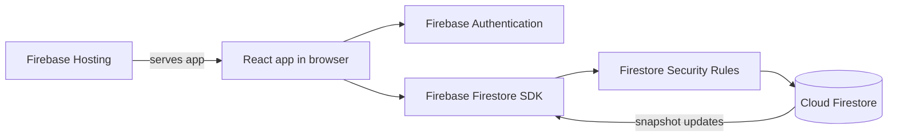

# StockSync project report

## 1. Problem and objective

Small shops often record inventory in notebooks or spreadsheets. A count can become stale between devices, and staff may not notice that an item needs reordering. StockSync is a cloud-based inventory web app that lets a shopkeeper see current stock, record why it changed, and receive low-stock warnings.

This is a Cloud Computing mini project. Its goal is a useful, explainable application, not a production-scale enterprise inventory system.

## 2. Implemented features

- Firebase Authentication with email/password, Google sign-in, email verification, and password reset.
- Product creation, editing, deletion, CSV import, SKU/barcode lookup, and category search.
- Sales, restocks, returns, damaged stock, physical counts, movement history, and undo.
- Low-stock and sold-out indicators, reorder suggestions, open orders, expiry reminders, and a live dashboard.
- Customer credit balances and payments; stock and credit for a sale commit together.
- Staff invitations with restricted product and price permissions.
- Responsive English/Hindi interface, offline caching for supported writes, and Firebase Hosting deployment.

## 3. Cloud architecture and data flow

Firebase Hosting serves static React assets. Firebase Authentication identifies the user. The browser talks to Cloud Firestore through the Firebase SDK; Security Rules authorize each read and write. `onSnapshot` listeners update the product list, history, and dashboard without a page refresh. No custom application server is required.

Firestore paths include `users/{ownerId}/products`, `movements`, `customers`, `creditEntries`, `profile`, and `members`. Membership and invite records allow a staff account to access one owner's shop. Product document IDs are generated by Firestore. Server timestamps record creation and updates.

## 4. Inventory logic

For each product, `quantity` is the stock on hand and `lowStockThreshold` is its warning level. A positive quantity at or below the threshold is low; zero is sold out. The dashboard totals are calculated from live product documents. A reorder suggestion is the amount needed to reach `targetStock`, minus stock already on order.

Connected stock changes use a Firestore transaction. It reads the current product, validates the requested amount, computes the next quantity, and writes both the product and its movement record atomically. If another client changes a read product before commit, Firestore retries against the new value. A sale on credit also updates the customer balance and writes a credit entry in the same transaction.

Offline transactions cannot run. When the browser reports offline, relative sales, restocks, returns, and damage can queue as batched `increment` writes. A count, an order receipt, and a sale beyond recorded stock require a connection because an absolute write could overwrite newer stock. Security Rules reject negative product quantities if a queued deduction becomes invalid when it syncs.

The History screen records before/after counts, notes, revenue, and the signed-in actor. Offline movement before/after counts can be approximate if another device changes stock before synchronization. This history explains actions made in the app; it is not a tamper-proof audit log against the shop owner.

## 5. Security and reliability

Firestore Security Rules require a verified Firebase account, restrict inventory access to the owner or authorized staff, validate document fields, and reject negative stock. Staff may record changes but cannot create or delete products or change prices. Rules deny access to unmatched collections by default.

Input validation checks names, quantities, thresholds, prices, and note lengths. Busy states prevent repeated form submissions. Sign-out waits for pending writes and clears Firestore's browser cache before ending the Auth session; a cache-clear failure is shown rather than hidden.

## 6. Testing and deployment

Run `npm test` for calculations and session behavior, `npm run test:rules` for Firestore emulator integration and security checks, `npm run lint`, and `npm run build`. Emulator tests cover account isolation, invalid stock, sales, credit, offline queuing, undo, and stale-screen stock changes. The production build is deployed with standard Firebase Hosting at <https://stocksync-b43cd.web.app/>.

The demo in [demo-viva.md](demo-viva.md) exercises a live product, sale, low-stock warning, history, and a second browser session. Automated tests do not replace a live two-device demonstration.

## 7. Cloud concepts and limits

StockSync demonstrates managed cloud services, centralized data, authentication, access control, real-time listeners, transactions, offline synchronization, and hosted deployment. Firebase manages the underlying infrastructure; this project has not performed enterprise-scale load testing.

Product expiry is one date per product, not per batch. The app does not process card payments, upload product photos, or forecast demand. Its navigation is local React state rather than URL-based routing because the mini project has a single authenticated shell. Offline stock changes are limited as described above, and the browser's online signal may not detect every network outage immediately.

## 8. Evaluation mapping

| Criterion                | Evidence                                                                      |
| ------------------------ | ----------------------------------------------------------------------------- |
| Problem understanding    | Sections 1 and 2 describe the shop inventory problem and features.            |
| Algorithm design         | Section 4 explains stock, warning, reorder, and transaction logic.            |
| Code quality             | React components, TypeScript service modules, validation, and Security Rules. |
| Testing and optimization | Unit tests, emulator tests, lint, production build, lazy-loaded screens.      |
| Documentation and viva   | This report, README, and the linked demo/viva guide.                          |

## 9. Verification record

On 31 October 2026, the local verification commands passed: 59 unit tests, 47 Firestore emulator tests, lint, and the production build. The emulator suite includes stale-screen and simultaneous two-client sales: two sales based on an earlier count of 10 finish at 2 units, with movements showing 10 to 6 and 6 to 2. It also checks offline queuing and blocked offline counts and oversells. The live Hosting build should be checked after deployment, and the two-window demonstration remains a presentation step rather than an automated browser test.

## 10. References

- [Firebase: Transactions and batched writes](https://firebase.google.com/docs/firestore/manage-data/transactions)
- [Firebase: Access data offline](https://firebase.google.com/docs/firestore/manage-data/enable-offline)
- [Firebase: Firestore Security Rules](https://firebase.google.com/docs/firestore/security/get-started)
