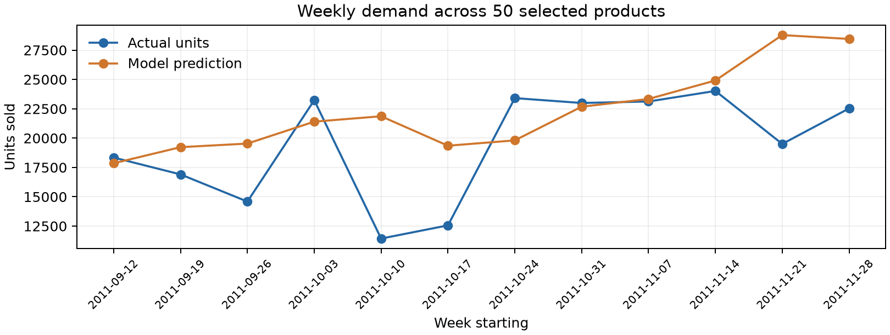
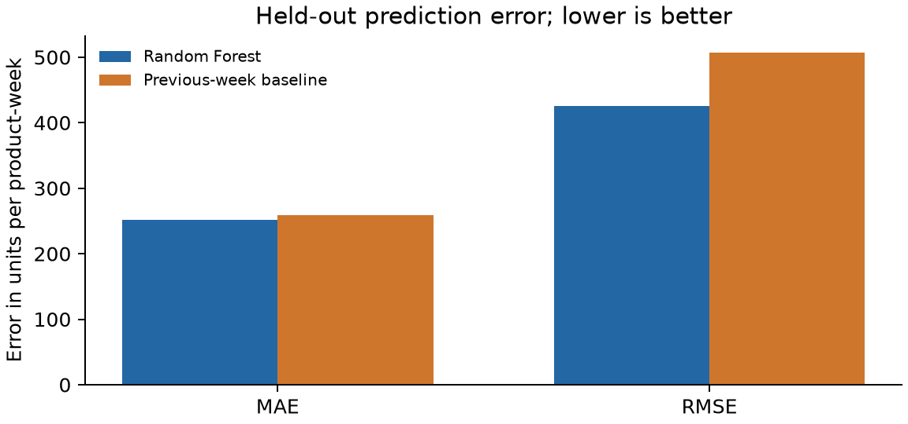

# StockSync Insights
## Retail Product Demand Prediction and Inventory Analytics

| Item | Value |
|---|---|
| Subject | Statistics and Data Analytics (SDA), Activity 2 mini project |
| Application | StockSync, a cloud inventory application |
| Dataset | UCI Online Retail II |
| Dataset period used | 7 December 2009 to 4 December 2011 |
**Prediction task:** Next week's units sold per product

## Abstract

StockSync records a shop's current products and stock movements. This independent SDA extension studies whether historical retail transactions can predict product demand. A Python pipeline cleans 1,067,371 real transactions, creates weekly sales series for 50 products, and trains a Random Forest regressor. The final 12 complete weeks are held out for evaluation against a previous-week baseline. On 600 product-week test cases, the model achieved MAE **251.286** units, RMSE **426.056**, and R² **0.278**. The baseline achieved MAE **258.475**, RMSE **507.413**, and R² **−0.024**. The modest MAE improvement supports a limited demonstration of demand prediction, not a claim of dependable shop-level forecasting.

## 1. Problem and scope

Retailers need to estimate future demand when planning purchases. Sales history can reveal patterns, but it is noisy and is not the same as stock-on-hand. This project predicts units sold in a week from earlier weeks' sales. It uses a public historical dataset for the SDA experiment and presents the results in StockSync's **Retail Insights** page. The app's live grocery products are unrelated to the dataset's UK giftware products. No prediction in this report is a recommendation for the current shop.

## 2. Dataset and attribution

**Source:** Chen, D. (2012), *Online Retail II*, UCI Machine Learning Repository, DOI [10.24432/C5CG6D](https://doi.org/10.24432/C5CG6D). The [dataset page](https://archive.ics.uci.edu/dataset/502/online+retail+ii) describes two years of transactions at a UK non-store retailer. Its licence is CC BY 4.0. The source workbook contains two yearly Excel sheets and 1,067,371 rows. It includes invoice, stock code, description, quantity, date, price, customer, and country, but no inventory level or product images.

**Source workbook SHA-256:** `bcbe73b35f5b7babf197fb0cb983a11f5d9ff929078d4aa53d171b1f2df2e980`. This identifies the exact 45,622,278-byte workbook used; the raw workbook is not committed or uploaded to Firebase.

## 3. Preprocessing and exploratory analysis

The pipeline reads both sheets and keeps positive-price, positive-quantity UK merchandise sales with valid product codes, dates, and descriptions. It removes cancellation invoices and returns rather than treating returned units as negative demand. Exclusions are applied in order, so each row receives one removal reason. Partial opening and closing weeks are dropped. Sales are summed by stock code and Monday–Sunday week; missing weeks for a selected product are explicitly filled with **zero** sales.

| Cleaning stage | Rows |
|---|---:|
| Source rows | 1,067,371 |
| Cancelled invoices | 19,494 |
| Returns or nonpositive quantities after cancellation removal | 3,457 |
| Nonpositive prices | 2,750 |
| Outside the United Kingdom | 83,169 |
| Invalid merchandise stock codes | 3,772 |
| Retained valid sales | 954,729 |
| In incomplete boundary weeks | 29,816 |
| Sales in complete weeks | **924,913** |

The 50 highest-volume products with at least 20 active sales weeks are selected **using only the pretest period**. This avoids letting test-period sales influence product selection. These products span many different demand levels and include wholesale purchases, so large week-to-week jumps remain possible.



## 4. Algorithm and evaluation design

Each row represents one product and one week. The target is that week's units sold. Features use only information already known before that week: sales in the previous four weeks, their four-week mean, the last observed unit price, calendar week, and one-hot encoded stock code. The first four weeks for each product cannot be scored because four lags are unavailable.

The model is `RandomForestRegressor(n_estimators=100, max_depth=12, min_samples_leaf=3, random_state=42, n_jobs=1)`. It is trained on **4,281 product-weeks** before 12 September 2011. The final **12 complete weeks**, 12 September through 4 December 2011, supply **600 test product-weeks**. No test targets enter training. A simple baseline predicts that each product will sell the same number of units as in the preceding week. Random splitting is inappropriate for this forecast because it can place later sales in training and earlier sales in testing; see [scikit-learn's time-series evaluation example](https://scikit-learn.org/stable/auto_examples/applications/plot_time_series_lagged_features.html).

**Metrics:** MAE is mean absolute error in units per product-week; RMSE penalizes larger errors; R² compares explanatory performance with predicting the test mean and can be negative. Predictions below zero are clipped to zero because unit sales cannot be negative.

## 5. Results and interpretation

| Method | MAE ↓ | RMSE ↓ | R² ↑ |
|---|---:|---:|---:|
| Random Forest | **251.286** | **426.056** | **0.278** |
| Previous-week baseline | 258.475 | 507.413 | −0.024 |

The model improves MAE by **7.189 units (2.8%)** and RMSE by **81.357 units (16.0%)** over the baseline on this single held-out period. R² is positive for the model but modest. The errors are still large for a product-level purchase decision, especially for products with unpredictable bulk orders. The main finding is that lagged sales carry useful information, while this model is insufficiently accurate to automate stock purchasing.



The app also shows a dated illustrative estimate for the week starting 5 December 2011. That estimate comes from retraining the same model on all complete observed weeks after the held-out evaluation. It is a historical demonstration and is not evaluated in this report because that future week is incomplete in the source workbook.

## 6. Application integration and data flow

```text
UCI Excel workbook (local) → clean sales → weekly product series
  → lag features → train / chronological holdout → measured metrics
  → versioned JSON → StockSync Retail Insights page (Firebase Hosting)
```

Only the small derived JSON is bundled with the website. Firestore remains responsible for real shop inventory and is not populated with the UCI transactions. The Insights page requires the normal StockSync login to navigate to it, but the historical JSON is a public static website asset; it contains no shop or customer data. No Python server, Cloud Function, or paid image storage is required.

## 7. Limitations and conclusion

- The dataset represents a 2009–2011 UK giftware and wholesale business, not a present-day Indian grocery shop. Its prices are in GBP and must not be compared with StockSync's INR values.
- Transactions record observed sales, not unmet demand or actual inventory. Stockouts, promotions, holidays, and supplier delays cannot be distinguished reliably from these fields.
- One 12-week holdout is a defensible mini-project evaluation but does not establish stable performance across seasons or retailers.
- The app's live sales history could support a shop-specific model later, after enough clean data accumulates and a separate evaluation demonstrates value. No such live forecast is claimed here.

The experiment satisfies the SDA goal of collecting a real dataset, cleaning it, implementing regression, measuring its performance, and presenting findings. The integrated StockSync page makes those findings easy to inspect while keeping the CC inventory and the SDA experiment distinct.

## 8. Reproduce the results

1. Download and unzip **Online Retail II** from the UCI link above. Check that the workbook SHA-256 matches the value in Section 2.
2. From the repository root, create a Python environment and install `analytics/requirements.txt`.
3. Run `python analytics/build.py --input /path/to/online_retail_II.xlsx`. This writes `src/data/retail-insights.json`.
4. Run `python -m unittest discover -s analytics -p 'test_*.py'` for cleaning and leakage checks.
5. Run `python analytics/render_report.py` to regenerate figures and this PDF from the JSON, then `npm run build` to bundle the results in the app.

The generated JSON includes the source hash, cleaning counts, model settings, holdout dates, metrics, and each selected product's 12 held-out actual and predicted values.
